# Automated Disaster Recovery with Proven RTO/RPO

Multi-region active-passive DR on AWS (Aurora Global Database, DynamoDB
global tables, Route 53 health-check failover, an automated failover
runbook) plus the part most DR setups skip: **a scheduled chaos drill that
breaks the primary region with AWS Fault Injection Service, lets the
automation recover on its own, and publishes the measured recovery time and
data loss.**

Most teams claim DR. Very few can show evidence that it works. This repo
is built to produce that evidence on a schedule and commit it next to the
code, including the runs that fail.

## Measured results

<!-- RESULTS:START -->
| Latest drill | Verdict | Measured RTO | Measured RPO | Target RTO / RPO |
|---|---|---|---|---|
| `drill-20261026T204238Z` | **FAIL** | 129.1 s | 33.0 s | 300 s / 5 s |

Across **2** drills: 0/2 passed, RTO p50 168.1 s / worst 207.1 s, worst RPO 33.0 s. Full history: [docs/RESULTS.md](docs/RESULTS.md).
<!-- RESULTS:END -->

Every number above comes from `evidence/drills/<run>/result.json`. The raw
per-second probe samples and the full Step Functions execution history sit
next to it, so each figure can be recomputed.

## What the first real drills found

The first session against real AWS (2026-10-26) ran three drills and one
failback. Two bugs surfaced that no local test, `terraform validate` or
checkov scan could catch, plus one genuine data-loss finding. All of it is
in the evidence folder, including the failures.

| Run | What happened | Result |
|---|---|---|
| `drill-20261026T201353Z` | Blocked before any fault was injected: the first `StartExperiment` in an account creates the FIS service-linked role, and the drill-control role was denied `iam:CreateServiceLinkedRole` | Not graded. Fixed with a permission scoped to that one role |
| `drill-20261026T201739Z` | Failover **worked**: Aurora promoted us-west-2, Route 53 moved traffic, 0 of 128 acknowledged writes lost. But the runbook never recognised the promotion and polled for 14 minutes | **FAIL**: RTO 207 s, RPO 0 s, runbook incomplete |
| failback after the fix | Planned `SwitchoverGlobalCluster` back to us-east-1, verified from outside | **88.6 s**, zero data loss |
| `drill-20261026T204238Z` | Runbook succeeded in **52 s**. RTO **129 s**, broken down as detect 12 s → promote 20.5 s → verify 31 s → DNS + client 64.5 s. Aurora lost nothing; **DynamoDB lost 33 acknowledged writes** | **FAIL**: DynamoDB RPO 33 s against a 5 s target |

### Bug: the runbook looked for a field that doesn't exist

Step Functions' AWS SDK integrations return field names from the Java SDK,
so the global-cluster member field is `DbClusterArn`. The CLI and boto3
spell the same field `DBClusterArn`. The runbook's writer-detection
expression used the boto3 spelling, so it never matched, even while Aurora
reported us-west-2 as the writer. Local validation passed because the test
data was written in boto3 casing; only a real execution exposed it. The fix
was then verified against the exact SDK response captured from the stuck
run.

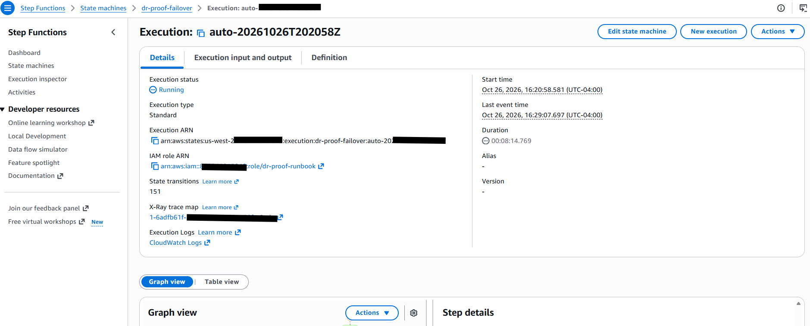
*The stuck execution: Aurora had already failed over, but the runbook kept polling `WaitForPromotion` ⇄ `CheckPromotion`.*

This run also changed the grading rules. The analyzer at the time graded it
**PASS**, because clients recovered within target. But a runbook that never
finishes means no notification, no verified state and a disarmed watchdog,
so the analyzer now fails any drill whose runbook doesn't complete. The run
was re-graded with the original inputs; the earlier PASS is kept as a prior
version in the versioned evidence bucket.

### Finding: DynamoDB RPO when the replication link fails first

In drill 3 the FIS experiment cut DynamoDB replication about 40 seconds
before the Lambda fault reached every execution environment. For that
window us-east-1 kept acknowledging writes that could no longer reach
us-west-2. The 33 lost writes (sequence 79–111) end exactly one write before
the first client error (sequence 112). Aurora lost nothing, because its
storage-level replication was never cut.

That's what real regional failures often look like: the network between
regions degrades before the application fails. **Asynchronous multi-region
replication can't guarantee a 5 s RPO in that scenario.** The writes
reappear once the region returns, but they are unavailable at failover time,
which is what RPO measures. Options:
- accept and document the RPO;
- make the application acknowledge a write only while replication is
  healthy (trading availability for durability);
- use DynamoDB multi-Region strong consistency, which gives RPO 0 but needs
  a third region or a witness. This is planned for the active-active phase.

Drill 2 never showed this: per AWS docs the replication pause can take up to
5 minutes to take full effect, and that time it hadn't. The same experiment
produced different exposure, which is exactly why drills need to run more
than once.

### Smaller observations
- **FIS ramps up gradually.** Detection took 80 s in drill 2 and 12 s in
  drill 3. The FIS Lambda extension picks up faults per execution
  environment on its own polling cycle, so during ramp-up some health probes
  still succeed and keep resetting the watchdog's "3 in a row" failure
  counter.
- **AWS retires engine versions.** Aurora PostgreSQL 16.6, the first version
  chosen, no longer existed in either region by deploy time. A pre-apply
  check caught it before a failed 20-minute apply.

## A drill in screenshots

All from the same session; run IDs match the committed evidence.

| | |
|---|---|
| 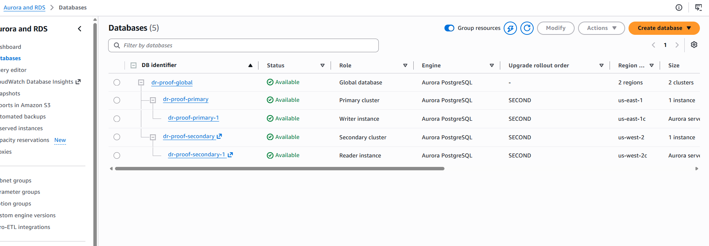 **Before:** one writer in us-east-1, a warm secondary in us-west-2 | 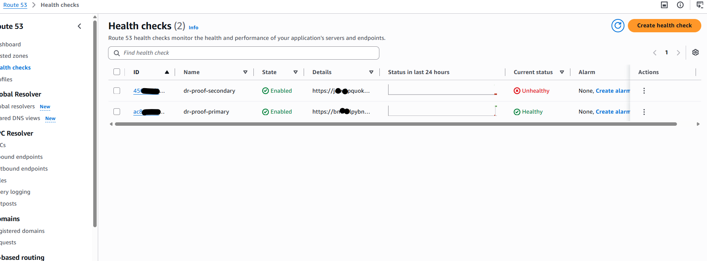 **Before:** the DR region reports unhealthy by design until it holds the writer |
| 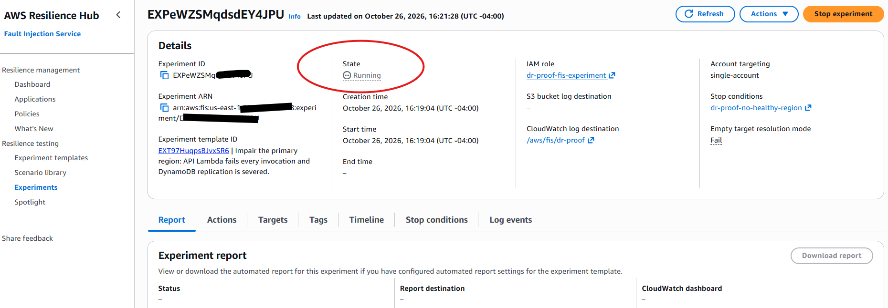 **Break it:** AWS FIS impairs the primary region | 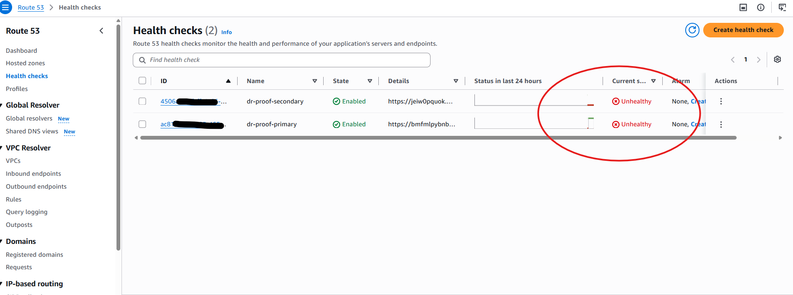 **Outage window:** neither region can commit writes |
| 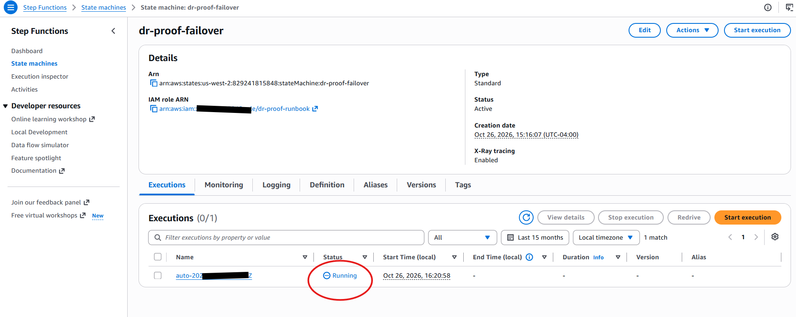 **Detect:** the watchdog in us-west-2 starts the runbook (`auto-…`, no human) | 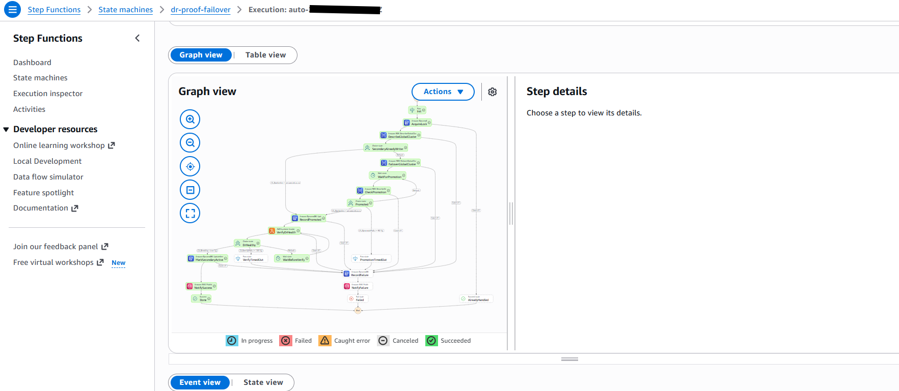 **Recover:** the failover runbook, all green |
| 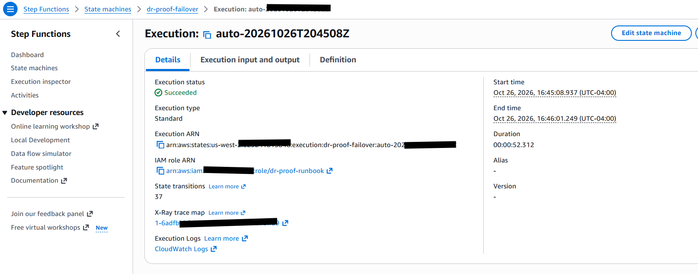 **52 seconds** from detection to verified DR | 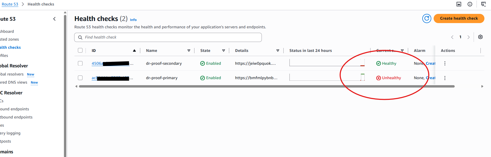 **Traffic moved:** the DR region now healthy |
| 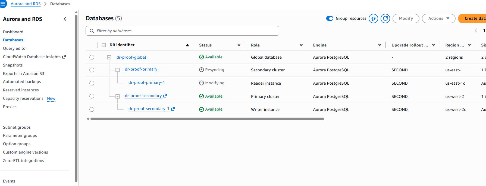 **After:** us-west-2 is the writer; the old primary resyncs | 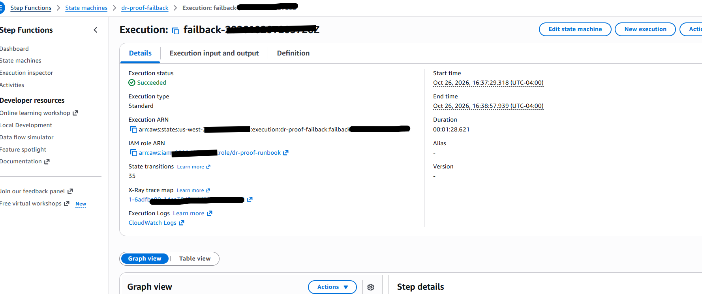 **Return trip:** planned failback in 88.6 s |
| 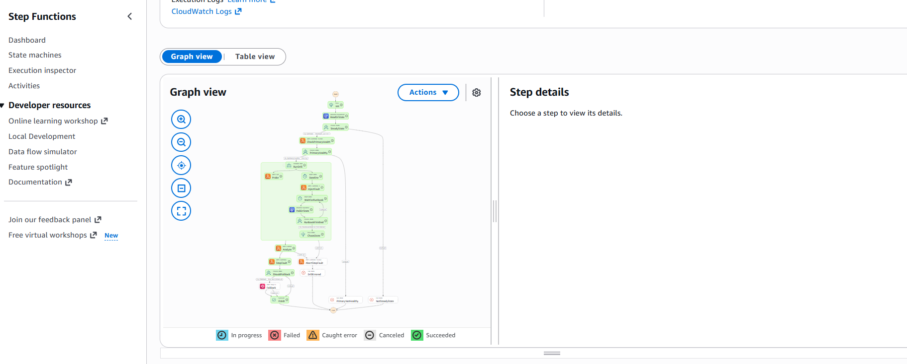 **The drill:** probe and chaos branches in parallel, then grading | 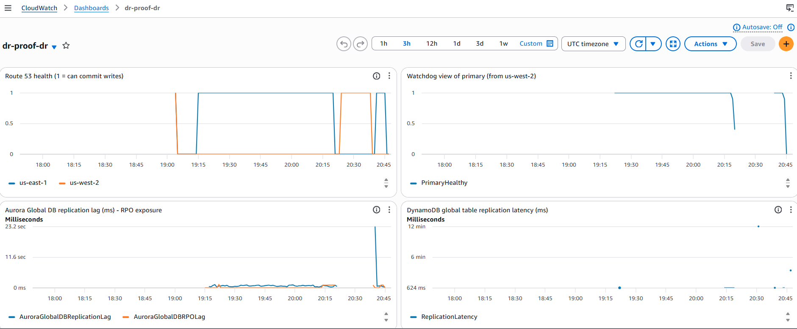 **The whole session** on one dashboard: apply, failover, failback, failover |

## Architecture

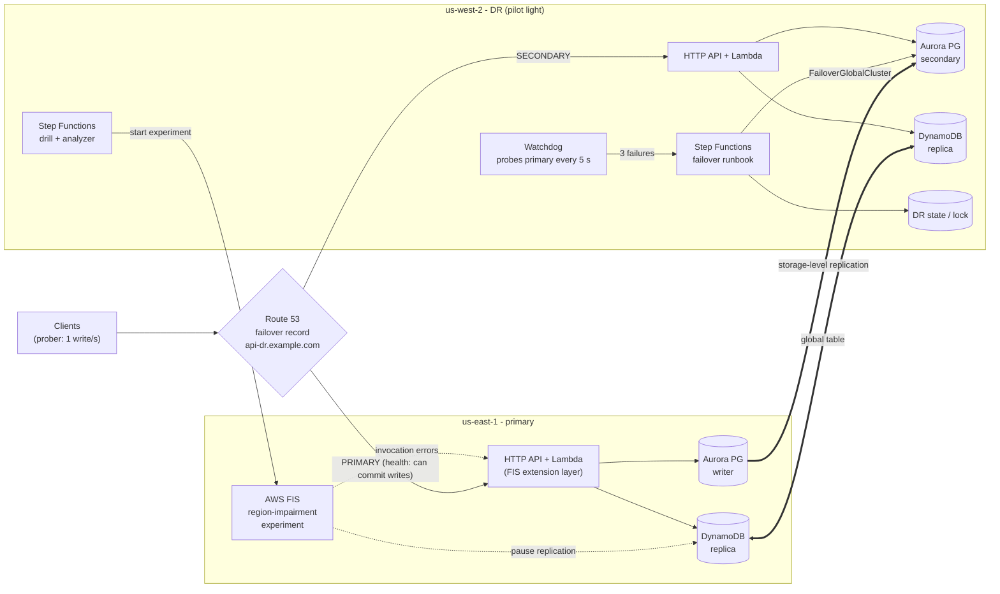

| Layer | Primary (us-east-1) | DR (us-west-2) |
|---|---|---|
| Compute | Lambda behind an HTTP API, regional custom domain | Identical, idle (pilot light costs ~$0) |
| Relational | Aurora PostgreSQL Serverless v2 writer | Global DB secondary with a warm reader |
| Key-value | DynamoDB global table replica | DynamoDB global table replica |
| Traffic | Route 53 `PRIMARY` failover record + health check | `SECONDARY` record + health check |
| Control plane | FIS experiment, fault-config bucket | Watchdog, failover/failback runbooks, drill, evidence bucket, dashboard |

## What a drill does

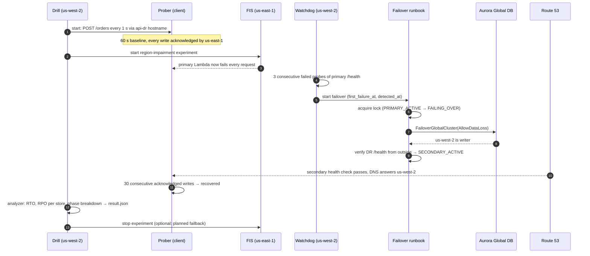

The drill never performs the failover itself. It breaks the primary and
watches. If the watchdog and runbook fail to recover the service, the drill
records a **FAIL**, which is the whole point.

## How RTO and RPO are measured

Measured from the client's side, never from the control plane's own report:

- **RTO**: from the first write that was *not* acknowledged to the first
  acknowledged write after recovery. It's the time a real client could not
  write, at 1 s resolution, and it includes detection, promotion, health-check
  flip and DNS TTL.
- **RPO**: a write only counts once the API returned `201 committed=true`,
  meaning both Aurora and DynamoDB accepted it. After failover the analyzer
  reads the DR region and looks for every write the old primary
  acknowledged. RPO is the largest window of acknowledged-but-missing writes;
  0 means nothing a client was told was saved got lost. Aurora and DynamoDB
  are graded separately.
- **Phase breakdown**: detection → runbook start → DB promotion →
  verification → DNS and client, built from timestamps the runbook records
  at each step.
- **Replication lag before the outage**: `AuroraGlobalDBReplicationLag`,
  `AuroraGlobalDBRPOLag` and DynamoDB `ReplicationLatency`, reported next to
  the measured loss as the theoretical exposure.

Missing evidence never counts as success:

| Situation | Verdict |
|---|---|
| Recovered via DR within the RTO target, no store over the RPO target | `PASS` |
| RTO or RPO over target, never recovered, or recovered on the primary (failover never happened) | `FAIL` |
| A store couldn't be read after failover (RPO unverifiable) | `FAIL` |
| The fault never caused a client-visible error | `INCONCLUSIVE` |

The grading logic is a pure module ([src/analyzer/rto_rpo.py](src/analyzer/rto_rpo.py))
with unit tests for each case ([tests/test_rto_rpo.py](tests/test_rto_rpo.py)).

## Design decisions

**1. Detection runs in the DR region, not on Route 53 alarms.** Route 53
health-check metrics and alarms only exist in us-east-1. Alarm-driven
failover would therefore depend on the failing region to announce its own
failure. Instead, a watchdog Lambda in us-west-2 probes the primary's
region-pinned endpoint every 5 seconds. The runbook, the drill, the state
table and the dashboard all live in the DR region too.

**2. Health means "this region can commit a write", so DNS follows the
writer.** `/health` runs a statement through the RDS Data API. Data API calls
against an Aurora global secondary fail until it is promoted, so the DR
region reports unhealthy until it really is the writer. After failover, the
old primary reports unhealthy the same way. When the fault clears, DNS
cannot flap back onto a read-only database. Failback is a deliberate,
planned switchover.

**3. Unplanned and planned paths are different APIs.** Failover uses
`FailoverGlobalCluster` with `AllowDataLoss`, because the runbook must assume
the primary is gone and cannot wait for it. Failback uses
`SwitchoverGlobalCluster` (zero data loss) and only after the old primary
reports `SynchronizationStatus = connected`.

**4. A lock prevents double failovers, and a human handles failures.** A
single DynamoDB item acts as both state machine and mutex:
`PRIMARY_ACTIVE → FAILING_OVER → SECONDARY_ACTIVE → FAILING_BACK →
PRIMARY_ACTIVE`. The watchdog only acts in `PRIMARY_ACTIVE`. A failed runbook
parks in `FAILOVER_FAILED` and pages, instead of retrying in a loop.

**5. Success is verified from outside.** The runbook only marks DR active
after a real HTTPS request to the DR endpoint commits through the full
stack.

**6. No NAT and no VPC Lambdas.** The Data API is HTTPS with IAM auth, so
the VPCs exist only for Aurora subnet groups. They have no internet path and
no inbound rules, and there are no NAT gateways to pay for.

**7. The chaos has guardrails.** The FIS experiment has a stop condition:
if neither region passes health checks for 15 minutes, the experiment aborts
and the primary is restored. The drill refuses to start unless the stack is
in `PRIMARY_ACTIVE` and the primary is healthy.

**8. Ephemeral by default.** An Aurora Global Database can't auto-pause, so
leaving it running would blow a small budget. The weekly workflow applies the
stack, drills, commits the evidence and destroys everything, so the stack
exists for about 60–90 minutes a week.

## What this does and doesn't prove

This section matters as much as the results:

- **FIS can't take down an AWS region.** The experiment simulates a region
  impairment: every primary API invocation fails, and DynamoDB replication
  out of the primary is paused. Aurora's storage-level replication keeps
  running during the drill. Aurora's measured loss therefore reflects
  in-flight lag at the moment writes stopped, which is why replication lag
  is reported next to it.
- DynamoDB pause-replication can take up to 5 minutes to take full effect
  (AWS docs), so some drills will show zero DynamoDB loss. That result is
  real, not a bug.
- The prober runs inside AWS, in the DR region. Real users' resolvers may
  cache DNS beyond the 60 s TTL, so real-world RTO for some clients can be
  longer than measured.
- The watchdog is a single vantage point. A network partition between the
  regions could look like a primary outage. In that case the primary could
  still be serving clients with cached DNS while Aurora promotes the DR
  region. That's the reason `auto_failover_enabled` exists: production
  systems often keep the runbook automated but the decision human.
- The API is unauthenticated apart from throttling. Route 53 needs a public
  `/health`, and per-region SigV4 signatures break across failover (the
  signature is bound to a region). A production system would use a
  region-agnostic JWT authorizer.

## Running it

### Prerequisites

- An AWS account with permission to create the resources in this repo
- An existing **public Route 53 hosted zone** (failover DNS needs a real domain)
- An S3 bucket for Terraform state
- Terraform ≥ 1.10, AWS CLI v2, bash (Git Bash on Windows), Python 3.12

### Manual run

```bash
cd terraform
cp terraform.tfvars.example terraform.tfvars   # set hosted_zone_name
cp backend.hcl.example backend.hcl             # set your state bucket
terraform init -backend-config=backend.hcl
terraform apply                                # ~25-35 min, mostly Aurora Global DB

cd ..
scripts/run-drill.sh              # ~10 min; add --failback to measure the return trip too
python scripts/publish_results.py # updates docs/RESULTS.md and the table above
scripts/teardown.sh               # stops any experiment, destroys with retries
```

### Scheduled drills (GitHub Actions)

[.github/workflows/dr-drill.yml](.github/workflows/dr-drill.yml) runs every
Monday at 06:00 UTC, or on demand. It authenticates through GitHub OIDC, so
there are no stored AWS keys. It applies, drills, commits the evidence,
destroys, and fails the job if the verdict isn't `PASS`.

Configure on the repo:

| Kind | Name | Value |
|---|---|---|
| Secret | `AWS_DRILL_ROLE_ARN` | IAM role trusted for this repo via GitHub OIDC (MaxSessionDuration ≥ 4 h) |
| Variable | `HOSTED_ZONE_NAME` | e.g. `example.com` |
| Variable | `TF_STATE_BUCKET` / `TF_STATE_REGION` | Remote state location |
| Variable | `ALERT_EMAIL` | Optional: failover notifications |
| Environment | `dr-drill` | Add required reviewers if you want a human gate |

For a long-lived stack, set `drill_schedule_enabled = true` instead. The
EventBridge Scheduler then runs drills inside AWS, with failback.

### Operating it

The human runbook (manual failover, failback, resetting the lock after a
failed runbook, break-glass CLI) is in [docs/runbook.md](docs/runbook.md). The
CloudWatch dashboard is in the DR region (`terraform output dashboard_url`).

## Cost

Rough estimates, not a quote; check Cost Explorer after your first run.

| Item | While the stack exists |
|---|---|
| Aurora Serverless v2, 0.5 ACU floor × 2 regions | ≈ $0.12–0.15 / hour |
| Route 53 health checks (HTTPS, 10 s interval) × 2 | ≈ $5 / month, prorated |
| KMS keys × 2, Secrets Manager secret + replica | ≈ $3 / month, prorated |
| Lambda, API Gateway, Step Functions, DynamoDB, FIS, Data API | cents per drill |

Run weekly as an ephemeral stack (about 90 minutes each time), that comes to
roughly $0.50 per drill, or about $2–3 a month. Left running permanently, it
costs about $100 a month or more. Don't do that on a hobby budget.

## Repository layout

```
terraform/
  data.tf          Aurora Global DB, DynamoDB global table, KMS, secrets
  app.tf           both regional app stacks, Route 53 health checks + failover records
  chaos.tf         FIS experiment, fault-config bucket, stop-condition alarm
  runbook.tf       DR state/lock, watchdog, failover + failback state machines
  drill.tf         prober, analyzer, drill state machine, evidence bucket
  dashboard.tf     CloudWatch dashboard (DR region)
  modules/         network, regional-app, lambda-fn
src/
  app/             regional order API (health = "can commit a write")
  watchdog/        DR-region detector
  prober/          synthetic client, 1 acknowledged write per second
  analyzer/        RTO/RPO grading (pure logic in rto_rpo.py)
  drill_control/   cross-region FIS control + external health checks
scripts/           run-drill.sh, teardown.sh, publish_results.py
evidence/drills/   committed drill evidence (result.json + samples.jsonl)
docs/              RESULTS.md (generated), runbook.md
```
